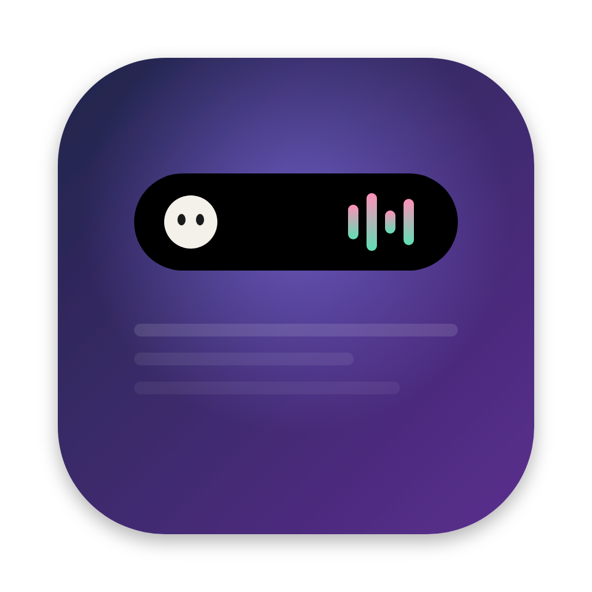

<p align="center"></p>

# DynaIsland

"Dynamic Island" ala iPhone untuk MacBook: musik, maskot, jadwal sholat, meeting, timer fokus,
shelf file + AirDrop, dan riwayat clipboard, semuanya di sekitar notch kamera.

## Pasang dengan satu baris

Buka **Terminal** (⌘ + Space, ketik "Terminal"), paste baris ini, lalu tekan Enter:

```bash
curl -fsSL https://raw.githubusercontent.com/barisbaru19-ux/dynaisland/main/install.sh | bash
```

Selesai dalam beberapa detik. Tidak perlu Xcode, tidak ada peringatan "damaged".
Untuk memperbarui nanti: klik ikon kapsul di menu bar → **Perbarui DynaIsland…**
(app juga memberi tahu kalau ada versi baru). Butuh macOS 12 atau lebih baru, Apple Silicon atau Intel.

---

- **MacBook dengan notch kamera** (14"/16" M1 Pro/Max ke atas): island membungkus kamera.
  Saat diam, maskot ada di kiri kamera dan jam di kanan. Saat lagu diputar, cover di kiri dan
  maskot yang berjoget + equalizer di kanan. Arahkan kursor ke notch dan island membuka ke bawah, menempel ke kamera.
  Semua isi berada di samping atau di bawah lensa, dan island hanya mengisi strip menu bar,
  jadi tidak pernah menutupi tab. Gaya lain: **Gaya pil (di bawah kamera)** di menu.
- **MacBook tanpa notch** (M1 Air, 13" M1 Pro): pil hitam kecil di tengah atas layar.

Notch dideteksi otomatis.

## Fitur

| Keadaan | Tampilan |
|---|---|
| Idle | Pil hitam kecil (bisa disembunyikan dari menu) |
| Musik diputar | Pil melebar: cover album + equalizer yang warnanya ikut cover |
| Ganti lagu | Pil melebar sebentar dan menampilkan judul lagu |
| Charger dicolok / dicabut | Notifikasi "Mengisi daya 84%" / "Pakai baterai" |
| Baterai 20% & 10% | Peringatan "Baterai lemah" |
| Volume diubah | Pop-up volume dengan bar level, menggantikan HUD volume macOS |
| Terisi 100% | "Terisi penuh" |
| 10 menit sebelum sholat | Nama sholat di kiri kamera, hitung mundur di kanan, bunyi saat masuk waktu |
| Timer fokus berjalan | Ring progres di kiri kamera, sisa waktu di kanan |
| Seret file ke notch | Island terbuka di tab Shelf, file disimpan di sana |
| 10 menit sebelum meeting | Judul meeting di kiri kamera, hitung mundur di kanan, bunyi saat mulai |
| Download selesai / ambil screenshot | Notifikasi singkat, file langsung masuk Shelf (juga screenshot dari Lightshot dll.) |
| Kursor diarahkan ke notch | Island terbuka dengan tab **Musik · Agenda · Sholat · Fokus · Shelf · Clipboard** |

### Maskot

Tiga maskot yang digambar langsung dengan kode: **Moci** (bola putih empuk), **Kucing** (oranye),
dan **Bit** (robot pixel). Ganti lewat ikon kapsul → **Maskot**, atau pilih **Tanpa maskot** untuk
kembali menampilkan baterai di kiri kamera.

| Kejadian | Maskot |
|---|---|
| Diam | Mengambang, berkedip, matanya mengikuti kursor |
| Musik diputar | Joget di samping equalizer, ada not ♪ |
| Mac tidak disentuh 2 menit | Tidur ("z z"), lalu kaget saat kamu kembali |
| Island dibuka | Melompat menyapa |
| File diseret ke notch | Membuka mulut, lalu senang setelah file disimpan |
| Charger dicolok | Petir kecil berkedip |
| Baterai ≤ 20% | Lesu dan berkeringat |
| Fokus atau istirahat selesai | Melompat senang |

Menu **Maskot → Lihat semua gerakan** memutar semua gerakan di atas sekali.
Baterai tetap terlihat di island yang terbuka dan di notifikasi charger.

Klik cover album di tab Musik untuk membuka Spotify / Apple Music.

### Tab di island yang terbuka

- **Musik**: cover, judul, artis, progress, tombol ⏮ ⏯ ⏭.
- **Agenda**: acara berikutnya dari app Calendar (iCloud, Google, Outlook yang sudah ditambahkan
  ke Calendar) dengan hitung mundur, lalu daftar sisa acara hari ini dan besok.
  Tombol **Gabung** muncul kalau ada link Zoom, Google Meet, Teams, Webex, atau FaceTime di acaranya.
- **Sholat**: sholat berikutnya + hitung mundur dan lima waktu hari ini.
  Saat hitung mundur muncul, tombol **Oke** menyembunyikannya sampai sholat berikutnya.
  Waktunya dihitung offline dengan parameter Kemenag (Subuh 20°, Isya 18°, ihtiyat) dan sudah
  dicocokkan dengan jadwal Bimas Islam untuk Jakarta. Selisih 1 menit dengan jadwal masjid setempat masih mungkin.
- **Fokus**: pilih 15/25/45/60 menit, lalu Mulai / Jeda / Berhenti. Setelah fokus selesai,
  istirahat 5 menit dimulai otomatis.
- **Shelf**: file yang diseret ke notch, plus download dan screenshot baru (otomatis). Seret keluar ke app lain, klik dua kali untuk membuka,
  klik kanan untuk Finder/AirDrop, atau **AirDrop** semua sekaligus. Shelf hanya menyimpan
  rujukan ke file aslinya dan kosong lagi saat app ditutup.
- **Clipboard**: 20 teks atau gambar terakhir yang kamu copy. Klik untuk copy lagi, klik kanan
  untuk menghapus. Hanya disimpan di memori (hilang saat app ditutup), dan isian yang ditandai
  rahasia oleh password manager tidak dicatat.

Island tetap terlihat saat berpindah desktop (Spaces).

## Cara pasang lain: dari zip (tanpa internet)

Versi bergambar: buka **Cara Pasang (baca dulu).html** di folder ini.

1. Klik dua kali **DynaIsland.zip** di Downloads. Folder `DynaIsland` muncul.
2. Buka foldernya, lalu klik dua kali **Pasang DynaIsland**.
   Terminal terbuka sendiri, app di-build, dipasang ke Applications, lalu langsung jalan.
3. **Pertama kali saja per download**, macOS menolak membukanya ("Not Opened" /
   "Apple could not verify…") karena file ini tidak ditandatangani akun developer Apple. Caranya:
   - Klik **Done**.
   - Buka **System Settings → Privacy & Security**, gulir ke bawah, klik **Open Anyway**
     di samping pesan tentang "Pasang DynaIsland", lalu masukkan password / Touch ID.
   - Klik **Open** di dialog berikutnya.
   Kalau pesannya **"is damaged and can't be opened"** (biasanya untuk file yang dikirim lewat
   WhatsApp/AirDrop), filenya sebenarnya tidak rusak. Klik **Cancel**, buka Terminal, ketik `bash `
   (dengan spasi), seret file **Pasang DynaIsland** ke jendela Terminal, lalu tekan Enter.
   Setelah itu klik dua kali sudah berfungsi.
4. Kalau Command Line Tools (compiler Swift) belum ada, jendela pemasangnya muncul otomatis.
   Pasang (gratis), lalu klik dua kali **Pasang DynaIsland** lagi.
5. Ikon kapsul muncul di menu bar. Saat pertama kali memutar musik, macOS akan bertanya
   **"DynaIsland ingin mengontrol Spotify/Music"**. Klik **OK**.
   Izin ini dipakai untuk posisi lagu, cover Apple Music, dan tombol kontrol.

Untuk memperbarui dari zip baru tanpa Terminal: simpan zip-nya ke Downloads. Island memberi tahu
"Update DynaIsland", lalu klik **Pasang update** di tab Shelf (atau menu kapsul → Perbarui → Pakai zip di Downloads).

Lebih suka Terminal? Dari folder `DynaIsland`: `./build.sh --install`.

Tidak perlu Xcode penuh, tidak perlu akun developer. Karena app-nya di-build sendiri di Mac kamu,
Gatekeeper tidak memblokir DynaIsland itu sendiri.

## Menu (ikon kapsul di menu bar)

- **Sembunyikan saat idle**: pil hilang kalau tidak ada musik atau notifikasi, tapi hover di tengah atas tetap memunculkannya.
- **Gaya pil (di bawah kamera)**: khusus Mac ber-notch. Island jadi pil yang melayang di bawah kamera.
- **Maskot**: pilih Moci, Kucing, Bit, atau Tanpa maskot.
- **Pop-up volume**: hanya di island (bawaan), hanya HUD macOS, atau keduanya.
- **Pengingat meeting (Kalender)**, **Riwayat clipboard**, **Download & screenshot ke Shelf**:
  nyalakan/matikan masing-masing fitur.
- **Jadwal sholat**: nyalakan/matikan hitung mundur dan pilih kota (25 kota di Indonesia).
  Waktu ditampilkan sesuai jam di Mac kamu.
- **Perbarui DynaIsland…**: unduh versi terbaru dari GitHub dan pasang otomatis.
- **Buka saat login**: otomatis jalan setiap Mac menyala (macOS 13+).
- **Coba animasi**: tes notifikasi charger tanpa harus mencabut kabel.
- **Izin Automation…**: membuka pengaturan kalau tadi tidak sengaja menekan "Don't Allow".
- **Keluar**

## Batasan yang perlu diketahui

- **Hanya Spotify dan Apple Music (app desktop).** Sejak macOS 15.4, Apple menutup akses
  "Now Playing" sistem untuk app pihak ketiga, jadi YouTube/Spotify di browser tidak terbaca.
- Kalau izin Automation ditolak, judul lagu tetap muncul, tetapi tombol kontrol mati dan
  cover Apple Music tidak tampil.
- Setiap kali di-build ulang, macOS mungkin menanyakan izin Automation lagi
  (karena tanda tangan app berubah). Itu normal.
- Pil otomatis minggir kalau jendela app yang aktif ada tepat di bawahnya (misalnya Chrome full screen
  atau di-maximize), supaya tidak menutupi tab. Arahkan kursor ke kamera untuk tetap membukanya.
  Notifikasi charger/baterai tetap muncul sebentar.
- **Pop-up volume**: secara bawaan hanya pop-up di island yang muncul, dan HUD volume macOS disembunyikan.
  Untuk itu DynaIsland perlu izin **Aksesibilitas** (ditanyakan saat pertama kali menekan tombol volume):
  System Settings → Privacy & Security → Accessibility → nyalakan DynaIsland. Sebelum diizinkan, hanya HUD
  macOS yang muncul, jadi tidak pernah ada dua pop-up. ⌥⇧ + tombol volume tetap mengubah per seperempat langkah.
  Pilihan lain di menu **Pop-up volume**: "Hanya HUD macOS" atau "Keduanya".
- Saat pertama kali jalan, macOS meminta izin **Kalender**, folder **Downloads**, dan **Desktop**
  (untuk screenshot). Klik **Allow / OK**. Seperti izin Automation, izin ini bisa ditanyakan lagi
  setelah build ulang. Kalau tidak sengaja ditolak: System Settings → Privacy & Security →
  Calendars / Files and Folders.
- Screenshot dari app lain (Lightshot, CleanShot, dll.): tekan **Copy** (⌘C) di app itu, dan gambarnya
  disimpan ke `Pictures/DynaIsland` lalu masuk Shelf. Kalau di-**Save**, simpan ke Desktop atau Downloads
  supaya ikut terdeteksi. Gambar baru yang disimpan ke Desktop juga ikut masuk Shelf.
- Download dianggap selesai kalau ukurannya tidak berubah selama 2 detik, jadi baru muncul
  beberapa detik setelah browser selesai. Yang dipantau hanya file baru, bukan isi lama folder.
- Agar tetap terlihat saat pindah desktop, app memakai fungsi tersembunyi macOS (sama seperti
  Boring Notch). Kalau suatu update macOS menghapusnya, island kembali hilang sebentar saat
  pindah desktop, tetapi fitur lain tetap jalan.

## Mengubah tampilan

Semua ukuran ada di `Sources/IslandModel.swift`:

- `IslandMode.plainSize`: ukuran tiap keadaan di layar tanpa notch
- `IslandLayout.size(for:)`: ukuran tiap keadaan di layar dengan notch
- `IslandLayout.wing` / `noticeWing`: lebar "telinga" di kiri-kanan kamera
- `IslandLayout.shoulderSize`: lengkungan kecil tempat island bertemu bezel
- `IslandLayout.bottomRadius(for:)`: kelengkungan sudut

Animasi pegas ada di `Sources/IslandViews.swift` (`.spring(response:dampingFraction:)`).
Bentuk, warna, dan gerakan maskot ada di `Sources/Mascot.swift` (`MascotPainter`, `Motion`, `Face`).
Setelah mengubah, jalankan `./build.sh --install` lagi.

## Uninstall

Klik dua kali **Hapus DynaIsland** di folder `DynaIsland`. App, pengaturan, dan izin Automation-nya ikut dihapus.

## Struktur kode

```
Sources/
  App.swift               entry point + menu bar
  IslandController.swift  panel melayang, posisi, deteksi hover
  IslandModel.swift       state & ukuran tiap mode
  IslandViews.swift       tampilan SwiftUI + animasi
  NowPlayingMonitor.swift Spotify / Apple Music (notifikasi + AppleScript)
  BatteryMonitor.swift    charger & baterai (IOKit)
  VolumeMonitor.swift     pop-up volume (Core Audio)
  FeatureViews.swift      tab Sholat / Fokus / Shelf + tampilan ringkasnya
  PrayerTimes.swift       hitung jadwal sholat offline + hitung mundur
  SpaceFix.swift          island tetap terlihat saat pindah desktop
  Mascot.swift            gambar & animasi maskot
  DailyTools.swift        riwayat clipboard, meeting dari Calendar, pantau Downloads/screenshot
  DailyViews.swift        tab Agenda & Clipboard + tampilan meeting di notch
  Updater.swift           cek versi baru di GitHub + pasang update tanpa Terminal
  MediaKeys.swift         tombol volume ditangani sendiri, supaya HUD macOS tidak ikut muncul
Resources/AppIcon.svg     logo (sumber); AppIcon.png dipakai build.sh untuk ikon app
install.sh                pemasang satu baris (curl)
.github/workflows/        build otomatis di Mac milik GitHub, hasilnya di Releases
```
